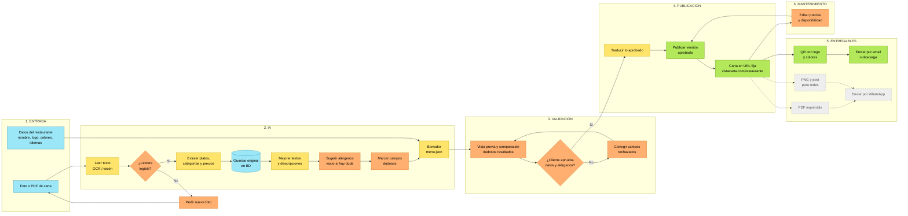
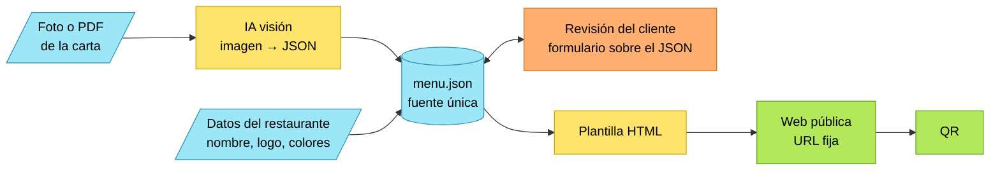

# VistaCarta — Flujos (v1, 2026-11-05)

Visor renderizado: [flujos.html](flujos.html) · Diagrama original: [flujo-v0.png](flujo-v0.png)

## Grafo 1 — Flujo completo (con recomendaciones)

Leyenda: azul = datos/entrada · amarillo = IA automática · naranja = revisión humana · verde = publicado/entregable · gris punteado = v2 (fuera del MVP)



## Grafo 2 — MVP enfocado en input → output

El JSON es el contrato: la IA lo produce, el cliente lo corrige, la web se genera de él.



## Borrador del contrato `menu.json`

```json
{
  "restaurante": {
    "slug": "la-buena-mesa",
    "nombre": "La Buena Mesa",
    "logo_url": "…",
    "colores": { "primario": "#B22222", "secundario": "#FFF5E1" },
    "moneda": "PEN",
    "idiomas": ["es", "en"]
  },
  "categorias": [
    {
      "nombre": "Entradas",
      "platos": [
        {
          "id": "p1",
          "nombre": "Causa limeña",
          "descripcion": "Papa amarilla, limón y ají, rellena de pollo.",
          "precio": 18.0,
          "disponible": true,
          "alergenos": ["huevo"],
          "alergenos_confirmados": false,
          "dudoso": ["precio"]
        }
      ]
    }
  ],
  "version": 1,
  "estado": "borrador"
}
```
